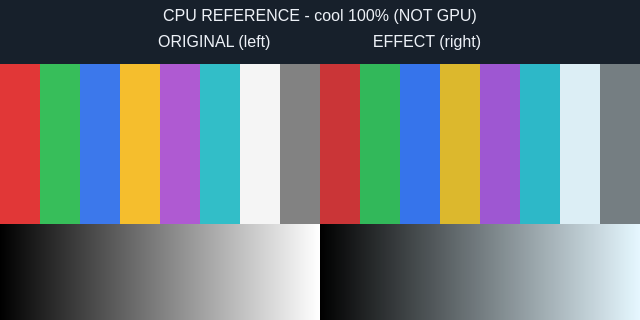

# Shader Deck

**Try a different tone. Keep it only when you choose.**

[](https://github.com/Battlelamb/omarchy-shader-deck/actions/workflows/ci.yml)

[Effects](#six-effects-plus-a-clear-switch) · [Intensity](#dial-in-the-strength) · [Controls](#preview-keep-restore) · [Install](#install-and-open) · [Recovery](#recovery-has-boundaries)

A native Omarchy panel for fixed screen filters with adjustable intensity. Try an effect for 15 seconds, Keep it for the session, or return to your recorded original shader. No filter is automatically enabled at startup and no Hyprland startup configuration is rewritten.

> [!NOTE]
> **Development source snapshot · 0.3.0**, not a stable release or tagged build. Live testing verified the new runtime loaded and the populated panel opened, was captured and closed. Live Apply/Preview/Keep/Restore actions and Hyprland `screen_shader` integration are not qualified; the separate full nested upgrade/rollback gate remains blocked.

> [!IMPORTANT]
> **GPU fragment math is not full desktop qualification.** An isolated NVIDIA EGL/GLES probe passed **24/24** static/generated-effect cases, with at most one RGBA8 code-value error and exact alpha. It does not qualify Hyprland integration, HDR, monitor color management or real-shell recovery. The comparison images below are **CPU references, not GPU screenshots**.


*Historical 0.2.1 native Qt/Quickshell capture from an isolated headless compositor, using an illustrative catalogue. Actions were not exercised. It shows the earlier three-entry UI, not the six effects, intensity control or current recovery flow. [Preview provenance](docs/PREVIEW.md).*

## Six effects, plus a clear switch

All six fixed transforms preserve sampled alpha. Descriptions below refer to **100% intensity**, not a color-managed prediction of your monitor.

| Effect | Full-strength RGB transform |
|:---|:---|
| **Cool** | Reduce red to 90% and green to 97%, leaving blue unchanged. |
| **Sepia** | Apply a clamped three-channel sepia matrix. |
| **Soft contrast** | Compress contrast around mid-gray with a 0.75 multiplier. |
| **Dim** | Reduce RGB brightness to 65%. |
| **Grayscale** | Convert RGB to Rec.709 luma. |
| **Readable warm** | Leave red unchanged; reduce green to 96% and blue to 88%. |
| **Disable shader** | Clear the shader immediately, without a trial; retain explicit Restore. |

No arbitrary GLSL import, custom shader path, downloaded effect or medical/color-accuracy promise is included. Readable warm is a fixed channel filter, not a calibrated color-temperature control.

## Dial in the strength

Open **Configure → Effect intensity (%)**, enter a whole number from **0–100**, then choose **Save settings**. Saving does not reapply the active effect; choose Apply or Preview afterward.

| Intensity | Result on the next Apply / Preview |
|:---:|:---|
| **0** | Clear the shader, with no timed trial. |
| **1–99** | Mix original RGB with the selected fixed transform using a private, content-addressed generated shader. |
| **100** | Use the bundled full-strength shader. This is the default. |

### A reference chart, not your desktop



*Original project-authored CPU chart. It is not a capture of live windows, current intensity, GPU output, HDR or monitor color management.*

Each effect has a local full-strength comparison chart. **More → Compare** opens that reference and explains it without changing the compositor. The chart stays at 100% even if your intensity setting is lower.

## Preview, Keep, Restore

Type to search and use the arrow keys to select. A tile click selects only; it does not apply. Open **More** for Preview, Compare, favorites and collections.

| Control | What happens |
|:---|:---|
| **Enter / Apply** | Start a 15-second trial for any nonempty effect. |
| **More → Preview** | Start the same independently timed trial. Shader Apply is already a preview. |
| **Keep** | Confirm only the matching current, unexpired trial; retain the original Restore snapshot. |
| **Restore** | Return the recorded first baseline shader, not the selected effect. Available even when search has no results. |
| **Disable shader / intensity 0** | Clear the shader immediately and retain explicit Restore; no Keep countdown. |
| **More → Compare** | View a local CPU reference only. Does not start a trial. |
| **Escape / click outside** | Dismiss, not Undo. Escape first backs out of Configure or a reference chart. An active trial still has its watchdog. |

The countdown belongs to a **detached Python watchdog**, not a QML panel timer. Closing or killing the panel caller does not by itself cancel rollback. Keep confirms a session-only choice, not a persistent startup effect.

## Install and open

Requires the **Omarchy Quattro shell**, compatible Quickshell/Qt with native `qs.Ui` and `qs.Commons`, system Python 3, `hyprctl` and compatible compositor/GPU support. The provider adapter is restricted to **Hyprland Lua 0.56.2**; other versions fail closed. No sibling plugin or shared installed framework is required.

Plugins run unsandboxed inside the shell. Review source and the limits above before installing this development snapshot:

```sh
omarchy plugin add https://github.com/Battlelamb/omarchy-shader-deck --enable
omarchy-shell shell summon leviathan.shader-deck
```

Installation does not automatically apply an effect or add a shortcut.

<details>
<summary><strong>Optional: Super+Space → Appearance → Shader Deck</strong></summary>

Back up `~/.config/omarchy/extensions/omarchy-menu.jsonc`, then merge this entry into its existing top-level object. Preserve other entries and JSONC comments; do not replace the file. This menu entry is **not auto-installed**.

```json
{
  "appearance.shader-deck": {
    "label": "Shader Deck",
    "action": "omarchy-shell shell summon leviathan.shader-deck"
  }
}
```

</details>

## Local preferences and files

Favorites, recents and named collections stay local; **More** exposes organization controls. **Configure → Reset preferences** clears those preferences and resets intensity to its default. It does **not** disable an active shader, reapply an effect, remove generated shaders or delete recovery journals.

| Stored data | Location |
|:---|:---|
| Preferences | `${XDG_CONFIG_HOME:-$HOME/.config}/omarchy/lego/shader-deck/preferences.json` |
| Per-session recovery and generated shaders | `${XDG_STATE_HOME:-$HOME/.local/state}/omarchy-shader-deck/` |

Data lives outside the installed source. Generated shaders are hash-checked before reuse and recovery; edited generated files are preserved and treated as conflicts, not overwritten. There is no capture/import/export interface for arbitrary shader programs. [Backend CLI, intensity generation and state contract →](BACKEND.md)

## Recovery has boundaries

Apply records actual shader state before writing. Restore and timeout **refuse divergent external edits** and retain the recovery journal. Other shader tools or config reloads can therefore block recovery intentionally rather than be overwritten.

This is value-level conflict detection, not a global compositor lock. Same-value edits that change away and back (ABA) remain indistinguishable. A watchdog cannot survive logout, missing runtime files or broken IPC indefinitely. Keep the installed source available until recovery completes, and do not delete a journal to hide a conflict. Screen shaders may affect capture or performance differently on real hardware; verify your setup independently.

**Restore before disabling or removing:**

```sh
omarchy plugin disable leviathan.shader-deck
# Only if you also want to uninstall:
omarchy plugin remove leviathan.shader-deck
```

Remove the optional menu entry separately. Disable shader means clear the effect; disabling the plugin or Reset preferences is not the same operation and is not a substitute for Restore.

<details>
<summary><strong>Checks, qualification limits and troubleshooting</strong></summary>

- Frozen 0.3.0 offline logic/transport and native component checks passed. Coverage includes real Lua fixtures, GLSL syntax checks, measured CPU chart pixels, killed callers, watchdog handoffs and lost-acknowledgement recovery controls.
- The isolated NVIDIA EGL/GLES **24/24** result is fragment-math evidence only. Hyprland `screen_shader`, real-shell Apply/Preview/Keep/Restore, HDR and monitor color management remain unqualified.
- Owner-authorized live testing verified new runtime loading and populated-panel open/capture/close only. The separate full nested old/new/rollback gate remains blocked.
- The **Component checks** badge links to this repository's actual `ci.yml` status. A green component result would not qualify desktop or GPU actions. See the [workflow](.github/workflows/ci.yml) for its exact scope.

From a reviewed checkout, with an existing private scratch directory in `TMPDIR`:

```sh
TMPDIR="${TMPDIR:?Set an existing private scratch directory}" env -u PYTHONPATH PATH=/usr/bin /usr/bin/python3 scripts/run-tests.py --backend-only
# Full local component/native suite, using the same private TMPDIR:
bash test.sh
```

The backend suite also needs the already-installed `glslangValidator` and ImageMagick for offline syntax/reference controls. Neither is a runtime dependency.

If settings seem unchanged, remember that saving intensity requires a later Apply/Preview. A reference chart always shows full strength. If recovery reports a conflict, preserve the receipt and generated file, check external edits and IPC, resolve the conflict deliberately, then retry Restore. Do not post private desktop captures, raw logs or window titles in reports.

[Backend contract](BACKEND.md) · [Recorded validation history](docs/VALIDATION.md) · [Contributing](CONTRIBUTING.md) · [Security](SECURITY.md)

</details>

---

**GPL-3.0-only** · Independent community plugin, not an official Omarchy or HyDE release. Grayscale retains its documented HyDE lineage; the other fixed filters and CPU comparison artwork are project-authored. [Source notices](NOTICE.md) · [Shader and artwork notices](NOTICE.backend.md) · [Full license](LICENSE).
