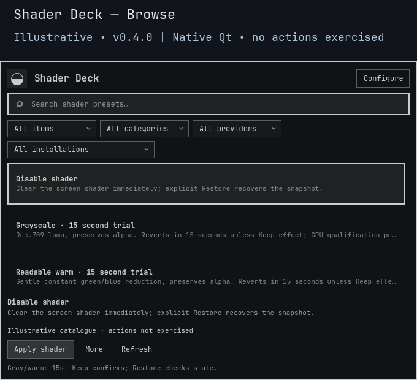
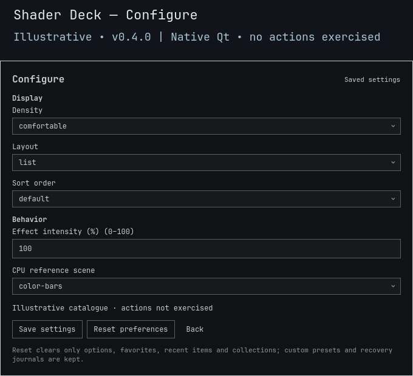

# Shader Deck

**Try a tone for 15 seconds. Keep it only when you choose.**

A native Omarchy panel for six fixed screen filters, saved intensity and explicit recovery. Nothing is automatically enabled at startup; no Hyprland startup configuration is rewritten.

> **v0.4.0 source candidate.** This change does not install effects or qualify live Apply/Preview/Keep/Restore. Hyprland screen-shader integration, HDR, monitor color management and the separate full-shell upgrade/rollback gate remain unqualified/blocked. [Validation history](docs/VALIDATION.md).




*Illustrative **0.4.0** native Qt component render with fictional/original example data. No installed library, desktop action or full-shell behavior is demonstrated. [Preview provenance](docs/PREVIEW.md).*

<details>
<summary>Preview native saved settings</summary>



*Illustrative Configure view; fields may scroll. The capture does not exercise Save or Reset.*

</details>

## Six effects and a clear switch

All fixed transforms preserve sampled alpha. These descriptions mean **100% intensity**, not calibrated monitor output.

| Effect | Full-strength RGB transform |
|:---|:---|
| Cool | Red × 0.90; green × 0.97; blue unchanged |
| Sepia | Clamped three-channel sepia matrix |
| Soft contrast | Contrast around mid-gray × 0.75 |
| Dim | RGB × 0.65 |
| Grayscale | Rec.709 luma in all three RGB channels |
| Readable warm | Red unchanged; green × 0.96; blue × 0.88 |
| Disable shader | Clear the shader immediately; retain explicit Restore |

No arbitrary GLSL, custom shader paths, downloads or medical/color-accuracy promises. Readable warm is a fixed channel filter, not calibrated color temperature.

## Intensity and reference scenes

Open **Configure**, set options, then **Save settings**. Saving never reapplies an active shader or starts a trial.

| Setting | Choices and behavior |
|:---|:---|
| Effect intensity (`intensity`) | Whole numbers **0–100**, default **100**. On the next Apply/Preview, 0 clears the shader, 1–99 uses a private content-addressed RGB mix, 100 uses the bundled shader. |
| CPU reference scene (`comparisonScene`) | `color-bars` (default) or `grayscale-ramp`. Changes only the fixed CPU comparison input scene, never intensity, GLSL or trial deadlines. |
| Density (`density`) | `comfortable` (default), `compact` |
| Layout (`layout`) | `list` (default), `grid` |
| Sort order (`sortOrder`) | `default` (default), `name`, `favorites-first` |

**More → Compare** shows the selected scene at full strength: original left, effect right. Charts are project-authored **CPU references labeled NOT GPU**, not live windows, current-intensity renderings, screenshots of GPU output or color-managed predictions. Switching scene does not change the screen filter. Historical isolated GPU fragment-math evidence in the validation history is a separate, narrower result—not qualification of these charts or Hyprland integration.

## Preview, Keep, Restore

Search and select with arrows or a row click; selection alone never applies. **More** holds secondary actions, favorites and collections.

| Control | Result |
|:---|:---|
| Enter / Apply | Start a **15-second** trial for a nonempty effect. |
| Preview | The same independently timed trial; Shader Apply is already a preview. |
| Keep | Confirm only the matching current, unexpired trial; retain the original Restore baseline. |
| Restore | Restore the first actual shader baseline, even with no search results. |
| Disable shader / intensity 0 | Clear immediately, without a trial; retain explicit Restore. |
| Compare | Open a fixed full-strength CPU reference; no compositor IPC or recovery journal write. |
| Escape / outside click | Dismiss, not Undo. Escape first leaves Configure or the chart. |

A **detached Python watchdog**, not a QML timer, owns rollback. Closing/killing the caller does not by itself cancel it. Keep lasts for this compositor session, not future startups.

Favorites, recents and collections are local. Reset clears those preferences and restores default intensity/scene/display options; it does **not** disable an active shader, reapply an effect, delete generated shaders or remove recovery journals. There is no shader capture/import/export interface.

Preferences live under `${XDG_CONFIG_HOME:-$HOME/.config}/omarchy/lego/shader-deck/`; per-session journals and generated shaders under `${XDG_STATE_HOME:-$HOME/.local/state}/omarchy-shader-deck/`. Generated files are hash-checked before reuse/recovery; edited bytes are preserved as conflicts. [Backend CLI and state contract](BACKEND.md).

## Open and remove safely

Requires Omarchy Quattro, compatible Quickshell/Qt (`qs.Ui`, `qs.Commons`), Python 3, compatible GPU support and **Hyprland Lua 0.56.2**. Other provider versions fail closed. Each plugin is independent, but runs unsandboxed inside the shell.

```sh
omarchy plugin add https://github.com/Battlelamb/omarchy-shader-deck --enable
omarchy-shell shell summon leviathan.shader-deck
# Restore in the panel BEFORE disabling or removing:
omarchy plugin disable leviathan.shader-deck
omarchy plugin remove leviathan.shader-deck
```

Install does not apply an effect or add shortcuts. An existing Super+Space → Appearance entry can summon the panel independently.

## Recovery boundaries and checks

Pending intent is durable before setters. Independent readiness must precede watchdog authority transfer; partial failures preserve pending compensation intent and the first baseline. Restore/timeout refuse divergent external edits and keep the receipt rather than overwrite another tool. Same-value **ABA edits cannot be detected**; this is not a global compositor lock. Logout, missing runtime files or persistent IPC failure can defeat recovery. Keep source/journals until recovery completes. Reset, dismissal and plugin removal are not substitutes for Restore.

From a reviewed checkout, with an existing private scratch directory:

```sh
TMPDIR="${TMPDIR:?Set an existing private scratch directory}" env -u PYTHONPATH PATH=/usr/bin /usr/bin/python3 scripts/run-tests.py --backend-only
bash test.sh
```

The offline backend suite also needs installed `glslangValidator` and ImageMagick for syntax and measured chart pixels; neither is a runtime dependency. Fake-HOME/IPC, CPU pixels and native component results do not prove live GPU/shell integration or hosted CI. [Preview provenance](docs/PREVIEW.md) records the current illustrative v0.4.0 Browse/Configure captures separately from historical images. They do not demonstrate live screen-shader output.

[Backend contract](BACKEND.md) · [Contributing](CONTRIBUTING.md) · [Security](SECURITY.md)

**GPL-3.0-only.** Independent community plugin, not an official Omarchy or HyDE release. Grayscale retains its documented HyDE lineage; other fixed transforms and CPU artwork are project-authored. Existing credits: [NOTICE.md](NOTICE.md), [NOTICE.backend.md](NOTICE.backend.md); [full license](LICENSE).
